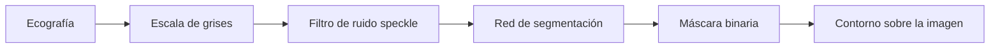

# 🩺 SpeckleDetectAI — Reducción de ruido y detección de lesiones en ecografías mamarias

Aplicación web que **reduce el ruido speckle** de una ecografía mamaria y **marca el contorno de la posible lesión** con una red neuronal de segmentación. Desarrollada en **Python** con **PyTorch**, **OpenCV** y **Streamlit**.

> ⚠️ **Proyecto académico.** No es una herramienta de diagnóstico médico: localiza la región sospechosa, pero no determina si la lesión es benigna o maligna.

---

## ✨ Funcionalidades

- Carga de ecografías en formato PNG, JPG o JPEG desde el navegador.
- Filtro propio de reducción de ruido speckle que suaviza la imagen y conserva los bordes.
- Segmentación de la lesión con una red neuronal (encoder ResNet-50 preentrenado y decoder).
- Visualización lado a lado de la imagen original y la imagen procesada, con el contorno de la lesión en verde.

---

## 🔍 Cómo funciona



### 1. Reducción de ruido speckle (`filtro.py`)

El speckle es el "granulado" característico de las ecografías: un ruido multiplicativo que dificulta distinguir los bordes de los tejidos. El filtro se aplica en **dos iteraciones**, y en cada una:

1. **Separa la imagen en dos regiones con el umbral de Otsu**, implementado a partir del histograma, para suavizar con distinta intensidad las zonas oscuras y las claras.
2. **Elige una ventana adaptativa para cada píxel**, desde 3×3 hasta 11×11. La ventana crece mientras la zona se mantenga homogénea, lo que se mide comparando invariantes de momentos de Flusser entre ventanas de tamaño consecutivo.
3. **Aplica un filtro adaptativo** basado en la media y la varianza locales, de la familia de los filtros de Lee y Kuan: suaviza más en las zonas homogéneas y conserva los detalles en las zonas con estructura.
4. **Realza los bordes** de las regiones claras, sumando a la imagen el 60 % de su diferencia con una versión desenfocada (*unsharp masking*).

### 2. Segmentación de la lesión (`unetresnet.py`)

- **Arquitectura:** encoder-decoder inspirado en U-Net.
  - **Encoder:** ResNet-50 preentrenado en ImageNet (*transfer learning*), que reduce la imagen de 256×256 a un mapa de características de 8×8×2048.
  - **Decoder:** cuatro convoluciones transpuestas, un sobremuestreo bilineal y una convolución 1×1 que reconstruyen una máscara de 256×256 con activación sigmoide.
- **Preprocesamiento:** la imagen se ajusta a 512×512 conservando su proporción, con relleno negro, y se redimensiona a 256×256.
- **Posprocesamiento:** la máscara se binariza con un umbral de 0,5, se lleva de vuelta al tamaño original y OpenCV dibuja el contorno de la lesión sobre la imagen filtrada.

### 3. Interfaz (`app.py`)

Interfaz web en Streamlit: el usuario sube la ecografía y la aplicación muestra la imagen original junto a la procesada.

---

## 🛠️ Tecnologías

| Tecnología | Uso |
|---|---|
| Python | Lenguaje principal |
| PyTorch y torchvision | Red neuronal de segmentación y encoder ResNet-50 |
| OpenCV | Momentos de imagen, desenfoque, redimensionado y contornos |
| NumPy | Operaciones numéricas del filtro |
| Pillow | Carga y ajuste de las imágenes |
| Streamlit | Interfaz web |

---

## 📁 Estructura del proyecto

```
SpeckleDetectAI/
├── app.py          # Interfaz web en Streamlit
├── filtro.py       # Filtro de reducción de ruido speckle
├── unetresnet.py   # Modelo de segmentación e inferencia
└── modelo50.pth    # Pesos del modelo entrenado (se descargan aparte)
```

---

## 🚀 Instalación y uso

1. Clona el repositorio:

   ```bash
   git clone https://github.com/JuanEstebanRodriguezCastellanos/SpeckleDetectAI.git
   cd SpeckleDetectAI
   ```

2. Instala las dependencias (se recomienda un entorno virtual):

   ```bash
   pip install streamlit torch torchvision opencv-python pillow numpy requests
   ```

3. Descarga los pesos del modelo entrenado desde [Google Drive](https://drive.google.com/uc?export=download&id=15rLHBPmfmN2XF8tSFjWs8M6gRV7cuSUl) y guarda el archivo como `modelo50.pth` en la raíz del proyecto.

4. Ejecuta la aplicación:

   ```bash
   streamlit run app.py
   ```

5. Abre `http://localhost:8501` en el navegador y sube una ecografía.

> La primera ejecución necesita conexión a internet, porque torchvision descarga los pesos de ResNet-50 preentrenados en ImageNet.

---

## ⚠️ Limitaciones y trabajo futuro

- **No diagnostica:** señala la región sospechosa, pero no clasifica la lesión como benigna o maligna.
- **Precisión de los bordes:** el decoder no tiene *skip connections*, así que reconstruye la máscara solo a partir del mapa de 8×8. Convertirlo en una U-Net completa mejoraría el detalle de los bordes.
- **Velocidad del filtro:** el filtro recorre la imagen píxel a píxel en Python, por lo que puede tardar en imágenes grandes. Vectorizarlo o usar Numba lo aceleraría.
- **Umbral fijo:** la máscara usa un umbral de 0,5, que podría ajustarse según la imagen.

---

## 👤 Autor

Desarrollado por **Juan Esteban Rodríguez Castellanos** como proyecto final de curso del programa de Ingeniería de Sistemas de la Universidad de Ibagué (2025).
